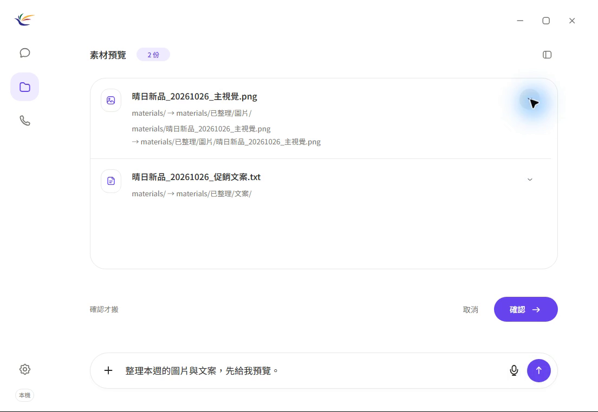

# MarVoiReflex

**結合 Agentic AI 的數位行銷工作流程語音助理**

國立臺北大學｜數位行銷進修學士學位學程｜專題製作（N4072）

指導教授：戴敏育

MarVoiReflex 協助小型商家的社群行銷人員，以中文語音或文字搜尋與整理活動圖片、文案等素材。系統顯示分類預覽，經使用者確認後執行搬移，並核對處理結果。

開發目標為 **Windows、CPU、8GB 記憶體、無獨顯**。目前已於 31.76GiB 記憶體主機完成 CPU 模式的特定技術檢查，8GB 實機驗證列於後續測試規劃。

## 下載與啟動

**[下載 Windows 自動下載工具（CMD）](https://github.com/yo20ywork-max/MarVoiReflex/releases/download/v0.1.0-preview-20261031/MarVoiReflex-Download-Windows.cmd)** ／ [發行頁面與手動下載](https://github.com/yo20ywork-max/MarVoiReflex/releases/tag/v0.1.0-preview-20261031)

1. 下載並雙擊 `MarVoiReflex-Download-Windows.cmd`。工具會下載 App 與模型、核對校驗碼並解壓縮，合計下載約 2.25GB。
2. 到使用者的 `Downloads\MarVoiReflex-20261031\MarVoiReflex` 資料夾，雙擊 `MarVoiReflex.exe`。
3. 進入任務畫面，按「示範」建立素材，再輸入「整理本週圖片與文案，先預覽」。檢查清單後，按畫面的「確認」執行。

這是免安裝版。下載工具會把本機模型與執行元件放到正確位置，不需另外安裝 Python、Node 或 CUDA。請保留程式旁的所有資料夾，並預留至少 6GB 磁碟空間。執行環境為 Windows 10/11 x64，需有 Microsoft Edge WebView2 Runtime 與 .NET Framework 4.8；語音回覆需 Windows 中文朗讀語音。環境準備與手動下載步驟見[使用指南](docs/user-guide.md)。

完整 App 超過 GitHub 單檔上限，因此分成約 693MB 的 App ZIP 與約 1.56GB 的模型檔。兩份檔案都提供公開下載，無需 GitHub 帳號。GitHub 自動產生的 **Source code** 是開發用原始碼。此版使用 CPU，8GB 實機與跨電腦相容性驗證仍待完成。

## 操作展示

[](docs/demo/MarVoiReflex-Material-Task-20261031.mp4)

[觀看 MP4](docs/demo/MarVoiReflex-Material-Task-20261031.mp4)／[GitHub 影片下載](https://github.com/yo20ywork-max/MarVoiReflex/releases/tag/demo-20261031)／[操作紀錄](docs/demo.md)

2026-10-31 實際操作 Windows App，輸入「整理本週的圖片與文案，先給我預覽。」系統列出兩份素材，經畫面確認後完成分類並逐檔驗證；上週文案與 CSV 保持原位。影片長約 3 分 42 秒，無聲、原速，保留操作與等待過程。

展示採合成素材、中文文字輸入與 MiniCPM5-2B CPU 模式。8GB 實機與語音操作的測試狀態見[技術驗證紀錄](docs/testing/feasibility.md)。

## 功能狀態

| 功能 | 狀態 |
|---|---|
| 聊天與任務分流 | 已實作；聊天模式獨立於檔案操作 |
| 素材匯入、清單與搜尋 | 已實作；操作範圍限定授權工作區 |
| 活動名稱、圖片／文案與日期篩選 | 已實作基本流程；日期依檔名判定 |
| 分類預覽、畫面確認、搬移與驗證 | 已實作；分類至圖片／文案資料夾 |
| 取消、同名檔及越界處理 | 已實作基本控制；完整案例驗證待完成 |
| 語音辨識與回覆 | 已整合 faster-whisper-small INT8 與 Windows SAPI |
| 指定 App／瀏覽器啟動 | 開發規劃中 |
| 自動發文與跨平台帳號操作 | 後續擴充項目 |

截至 2026-10-31，既有打包版通過 **17 項特定技術檢查**，涵蓋原生視窗、CPU 運行與部分素材操作流程。完整任務、真人語音及 8GB 實機測試另行規劃，詳見[技術驗證紀錄](docs/testing/feasibility.md)。

## 專案文件

- [研究需求與驗收對照](docs/requirements.md)
- [成果資料與驗證進度](docs/project-readiness.md)
- [研究簡報 PPTX](docs/presentation/MarVoiReflex-Revision-20261031.pptx)／[簡報說明](docs/presentation/outline.md)
- [研究定位與現有工具比較](docs/project-positioning.md)
- [MVP 功能規格](docs/mvp-spec.md)／[系統架構與工作流程](docs/architecture.md)
- [測試案例規劃](docs/testing/50-cases.md)／[CSV](docs/testing/50-cases.csv)
- [使用者研究方法](docs/testing/user-study.md)／[需求訪談規劃](docs/interviews.md)
- [商業模式畫布](docs/business-model.md)／[系統展示與操作紀錄](docs/demo.md)
- [團隊成員與分工](docs/team.md)／[16 週開發計畫](docs/roadmap.md)
- [成果交付規劃](docs/deliverables.md)／[開發議題與里程碑](docs/github-tracking.md)

## 團隊成員

| 職務 | 姓名 | 主要分工 | 聯絡方式 |
|---|---|---|---|
| 組長 | 唐丞佑 | 規劃進度、整合成果 | [yo20ywork@gmail.com](mailto:yo20ywork@gmail.com) |
| 組員 | 劉邦昱 | 語音輸入與語音回覆 | [xvxxeo@gmail.com](mailto:xvxxeo@gmail.com) |
| 組員 | 劉芮妘 | 畫面資訊與結果確認 | [llrayunn@gmail.com](mailto:llrayunn@gmail.com) |
| 組員 | 李心愉 | 理解指令、整理研究資料 | [omary389520@gmail.com](mailto:omary389520@gmail.com) |

## 開發環境與啟動

需要 Windows 11 x64、Python 3.12、WebView2，以及完整 CPU App 的執行資產，包括語言模型、ASR 模型、llama-server 與 Node／MCP。執行資產可從上方 Windows 發行檔案取得。詳細步驟見[開發與打包說明](docs/development.md)。

在 PowerShell 切換至倉庫目錄後執行：

```powershell
py -3.12 -m venv .venv
.\.venv\Scripts\python.exe -m pip install -r requirements.txt
.\.venv\Scripts\python.exe scripts/configure_runtime.py --app-root 'D:\Path\To\FullApp' --check-hash
.\.venv\Scripts\python.exe scripts/build_ui.py
.\.venv\Scripts\python.exe src/main.py
```

`--app-root` 指向含 `assets` 子目錄的完整 App。設定儲存於本機 `app-link.json`；開發資料預設儲存於 `.local-data/`，也可透過 `CROSSGEN_DATA_DIR` 指定獨立目錄。

## 專案結構

```text
src/       模型服務、安全控制器、語音與原生視窗
ui/        HTML、CSS、圖示、字型與互動元件
web/voice/ App 前端與語音控制器
runtime/   MCP bridge、元件版本與模型校驗資訊
scripts/   UI 建置、執行設定、Windows 打包與文件檢查
docs/      研究規格、系統設計、測試方法與驗證紀錄
```

## 授權與相關專案

原始程式授權條款見 [LICENSE](LICENSE)，第三方來源與授權見 [THIRD_PARTY_NOTICES.md](THIRD_PARTY_NOTICES.md)。

前期開發紀錄：[GhostReflex_System](https://github.com/yo20ywork-max/GhostReflex_System)。目前版本資訊見[發行紀錄](docs/releases/2026-10-31.md)。
