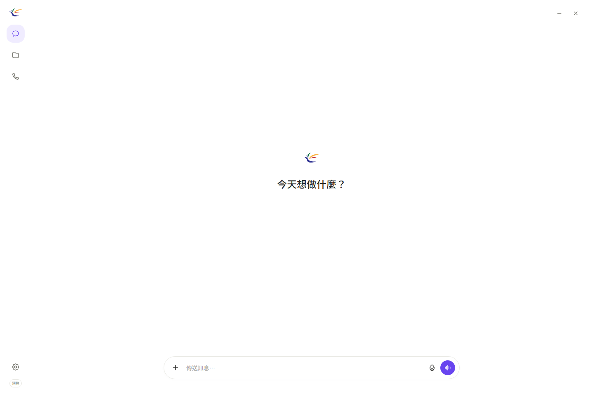

# MarVoiReflex

**結合 Agentic AI 的數位行銷工作流程語音助理**

國立臺北大學｜數位行銷學士學位學程｜四年級畢業專題｜指導教授：戴敏育

讓小型商家的社群行銷人員，用中文交代「把這週促銷的圖片和文案整理好」。系統先列出要搬的檔案，等你按確認才執行，最後核對結果。

> 開發中的 Windows 原型。以 **CPU、8GB 記憶體、無獨顯**為目標；目前證據來自 31.76GiB 主機，**尚未完成 8GB 實機驗收**。本倉庫公開可閱讀，原始程式授權依 [LICENSE](LICENSE)，不代表已採開源授權。



上圖是核可 HTML 介面的既有預覽，不是本輪原生視窗的桌面截圖。實際程式以 WebView2 原生無標題列視窗開啟。

## 目前能做什麼

| 項目 | 目前狀態 |
|---|---|
| 文字聊天／任務分開 | 已有；聊天不拿檔案工具 |
| 匯入素材、列清單、搜尋 | 已有；限授權的素材工作區 |
| 活動名稱、圖片／文案、本週／明確日期篩選 | 已有；依檔名日期，不猜照片內容 |
| 分類預覽 → 畫面確認 → 搬移 → 核對 | 已有；固定分類到圖片／文案資料夾 |
| 取消、越界拒絕、同名檔停止、操作紀錄 | 已有；仍需完整案例驗證 |
| 麥克風、中文辨識、語音回覆、回覆時間紀錄 | 已接入 faster-whisper-small INT8 + Windows SAPI；真人語音仍需擴充測試 |
| 開其他 App／瀏覽器 | **待開發**，不可用目前素材測試代替 |
| 自動發文、跨帳號操作 | 未納入本次 MVP |

截至 2026-10-31：既有打包程式通過 **17 項特定技術檢查**；這不是 50 組任務全部通過，也不是「任何任務都 100%」。詳見 [測試證據與限制](docs/testing/feasibility.md)。

## 先看教授要求

- [白話調整清單與 60 項對照](docs/professor-requirements.md)
- [修訂簡報 PPTX](docs/presentation/MarVoiReflex-Revision-20261031.pptx)／[逐頁講稿](docs/presentation/outline.md)
- [專題定位與現有工具比較](docs/project-positioning.md)
- [MVP 功能規格](docs/mvp-spec.md)／[系統架構與工作流程](docs/architecture.md)
- [50 組測試案例](docs/testing/50-cases.md)／[CSV](docs/testing/50-cases.csv)
- [使用者研究與成效指標](docs/testing/user-study.md)／[訪談 6–8 人的規劃](docs/interviews.md)
- [BMC 商業模式九格](docs/business-model.md)
- [Demo A／B／C](docs/demo.md)
- [組員與分工草案](docs/team.md)／[16 週計畫](docs/roadmap.md)／[會議紀錄範本](docs/meetings/TEMPLATE.md)
- [下次指導前交付清單](docs/next-review-checklist.md)
- [14 項待辦與 8 個兩週里程碑](docs/github-tracking.md)

## 從原始碼啟動

需要 Windows 11 x64、Python 3.12、WebView2，以及已有的完整 CPU App 資料夾。**只下載這個 GitHub 原始碼不能直接聊天**：模型、ASR、llama-server、Node／MCP 另行準備；本輪未上傳大型安裝包。詳見 [啟動與打包](docs/development.md) 和 [既有版本資訊](docs/releases/2026-10-31.md)。

在 PowerShell 切到本倉庫，執行：

```powershell
py -3.12 -m venv .venv
.\.venv\Scripts\python.exe -m pip install -r requirements.txt
.\.venv\Scripts\python.exe scripts\configure_runtime.py --app-root 'D:\Path\To\FullApp' --check-hash
.\.venv\Scripts\python.exe scripts/build_ui.py
.\.venv\Scripts\python.exe src\main.py
```

`--app-root` 必須指向含有 `assets` 子資料夾的完整 App。設定只寫入本機、被 Git 忽略的 `app-link.json`，不複製模型。原始碼版資料預設在 `.local-data/`；可以用 `CROSSGEN_DATA_DIR` 指到 D 槽的獨立資料夾。

## 目錄

```text
src/       CPU 模型服務、安全控制器、語音、原生視窗
ui/        可編輯的 HTML、CSS、圓弧 icon、字型與互動元件
web/voice/ 已產生的 App 前端與語音控制器
runtime/   MCP bridge、固定版本與模型校驗資訊（無權重）
scripts/   UI 建置、本機設定、Windows 打包、文件檢查
docs/      教授要求、簡報、規格、研究、測試、分工與證據
```

四位組員 Email、學程與既有分工已沿用原倉庫資料；個人 github.io、照片、訪談結果與新增工作的負責人仍待補齊。研究表格只提供格式，不填假數字。原始 GhostReflex_System 倉庫保留；此倉庫從目前 MarVoiReflex App 整理開始，沒有部署或合併舊分支。
