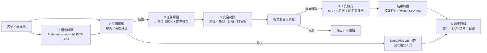
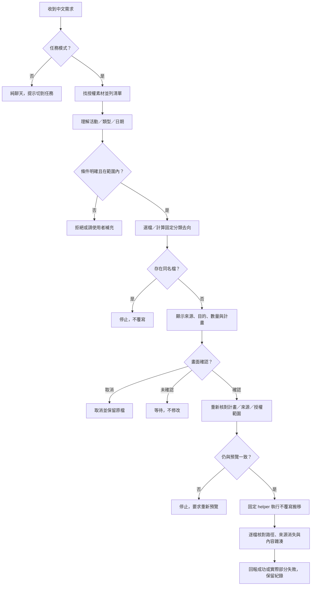

# 系統架構與完整工作流程

白話：先聽懂 → 分清楚你要什麼 → 排步驟 → 檢查可不可以做 → 等你同意 → 做完再核對。

模組編號依教授的六模組命名，不代表安全確認只能在執行前跑一次；執行前與確認時都重新檢查。

| 模組 | 現有檔案 | 實際工作 |
|---|---|---|
| 語音辨識 | src/voice_engine.py、web/voice/audio-worklet.js | 收音、短句辨識、繁體轉換；目前不是串流 Paraformer |
| 意圖理解 | src/runtime.py、assistant_modes.py、semantics.py | 聊天不執行；任務保留類型、日期、活動及否定條件 |
| 任務規劃 | src/intent.py、flow.py | MiniCPM5-2B 產生受限 JSON；控制器驗證，不直接信任模型 |
| 工具執行 | src/backend.py、flow.py、atomic_move.py、runtime/bridge.mjs | 本機 MCP stdio，固定 Windows 搬移 helper |
| 安全確認 | src/flow.py、atomic_move.py、main.py | 授權路徑、禁止連結越界、預覽計畫、按鍵確認、再驗證來源與同名檔 |
| 結果回報 | src/runtime.py、voice_engine.py、web/voice/live.js | 成功／失敗、分類摘要、語音、分段延遲及操作紀錄 |

## 一件任務從頭到尾

## 工具到底怎麼接

`MiniCPM5-2B → 受限 JSON → Python 安全控制器 → 本機 HTTP bridge → MCP stdio → Desktop Commander`。

實際使用 `@wonderwhy-er/desktop-commander@0.3.1`，不是 remote-desktop-commander 的 OAuth 雲端接法。只開放 list_directory、read_file、get_file_info、start_search、get_more_search_results、stop_search、start_process、read_process_output。即使工具名包含 start_process，也只能啟動控制器產生的固定搬移器；模型不能任意輸入終端命令。

此版具有限定工作流程的規劃與結果驗證，**不是模型自由選用完整工具庫**。教授要求的指定 App／瀏覽器啟動還需新增明確授權工具，不直接把完整命令列暴露給小模型。

## 資料與執行限制

模型 llama.cpp：CPU、4 執行緒、4096 context、單一並行、GPU layers 0。語音 faster-whisper small INT8 CPU，Windows SAPI 回覆。工作區、錄音、聊天及操作紀錄只留在使用者本機資料目錄，不放 GitHub。應用服務綁 127.0.0.1，前端／bridge 使用每次啟動產生的憑證；不是供網路上其他電腦直接連線的伺服器。
