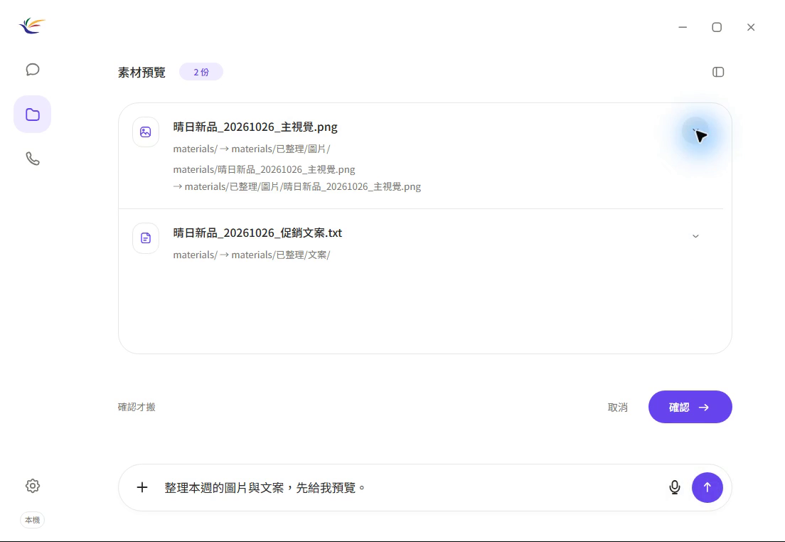
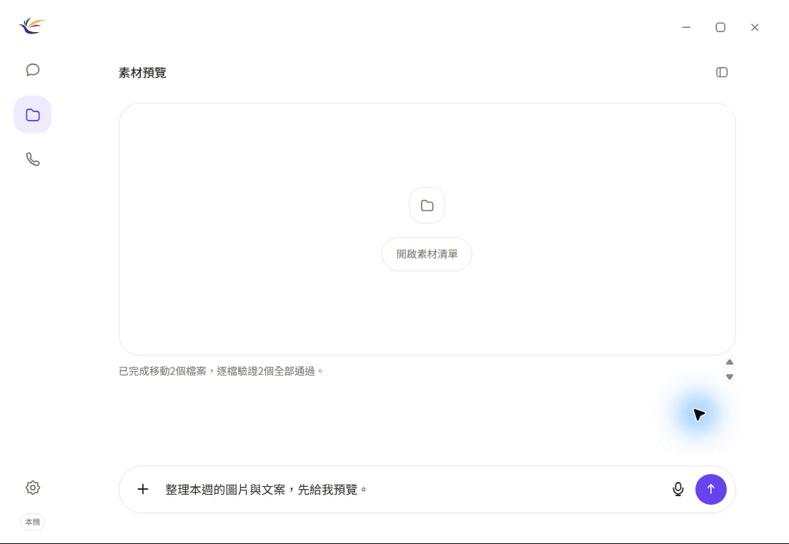

# 系統展示與操作紀錄

## 素材整理操作影片

[觀看 MP4](demo/MarVoiReflex-Material-Task-20261031.mp4)／[GitHub 影片下載](https://github.com/yo20ywork-max/MarVoiReflex/releases/tag/demo-20261031)／[檔案核對紀錄](evidence/demo-material-task-20261031.json)

錄製日期：2026-10-31。使用實際 Windows 桌面版 App、MiniCPM5-2B Q4_K_M CPU 推論與安全控制器，從介面載入四份合成素材，再以文字輸入「整理本週的圖片與文案，先給我預覽。」

影片依序呈現素材清單、分類預覽、目的路徑、畫面確認、執行回報與剩餘素材。全長 3 分 42 秒，無聲、原速連續錄製；畫面範圍限定 App，透明外框的四角以白色遮罩處理。

| 素材 | 操作結果 |
|---|---|
| 晴日新品_20261026_主視覺.png | 移至 `已整理/圖片/` |
| 晴日新品_20261026_促銷文案.txt | 移至 `已整理/文案/` |
| 晴日新品_20261025_上週文案.txt | 保持原位 |
| 晴日新品_20261026_成效.csv | 保持原位 |

預覽階段四份原檔皆未變動；確認後兩份選定素材完成搬移，四份檔案的內容雜湊皆保持一致。App 顯示「已完成移動2個檔案，逐檔驗證2個全部通過。」

展示主機配備 31.76GiB 記憶體，以 CPU 模式執行。此影片涵蓋 Demo B 的文字分類流程；中文語音、取消與異常情境、跨電腦啟動及 8GB 實機仍依下列規劃分別驗證。

## 展示環境

採合成素材與獨立資料目錄，記錄測試日期、程式版本、模型SHA-256及素材清單。展示前確認CPU模型與語音服務狀態。固定腳本與素材整理影片供現場操作使用。

## Demo A：指定工具啟動

輸入「開啟瀏覽器和指定活動資料夾」。驗收內容為白名單程式與授權路徑啟動，以及各步驟狀態回報。目前此工具列於開發規劃。

## Demo B：行銷素材整理

1. 匯入圖片、TXT與MD，顯示素材清單。
2. 輸入或說出「幫我整理本週促銷活動的圖片與文案」。活動名稱未明確時進行澄清。
3. 顯示選定檔案、來源與目的地、計畫ID及數量。
4. 演示取消流程，檢查原檔及雜湊保持一致。
5. 重新預覽並在畫面確認，將素材分類至圖片與文案目錄。
6. 展示實際檔案狀態、驗證摘要、語音回覆及處理延遲。

目前文字基準句為「整理本週的圖片與文案，先給我預覽」。其他說法依個別案例記錄結果。

## Demo C：異常與取消處理

展示不存在的資料夾、目的地同名檔、使用者取消、越界路徑及預覽後來源變動。系統回報具體原因並保留操作紀錄。口頭確認維持畫面授權流程；批次中途失敗則列出已完成與未完成項目。

## 展示紀錄

紀錄包含實際指令、素材manifest、預期與實際結果、各階段時間及錯誤。公開資料採去識別摘要；原始音訊與存取憑證儲存於本機。
